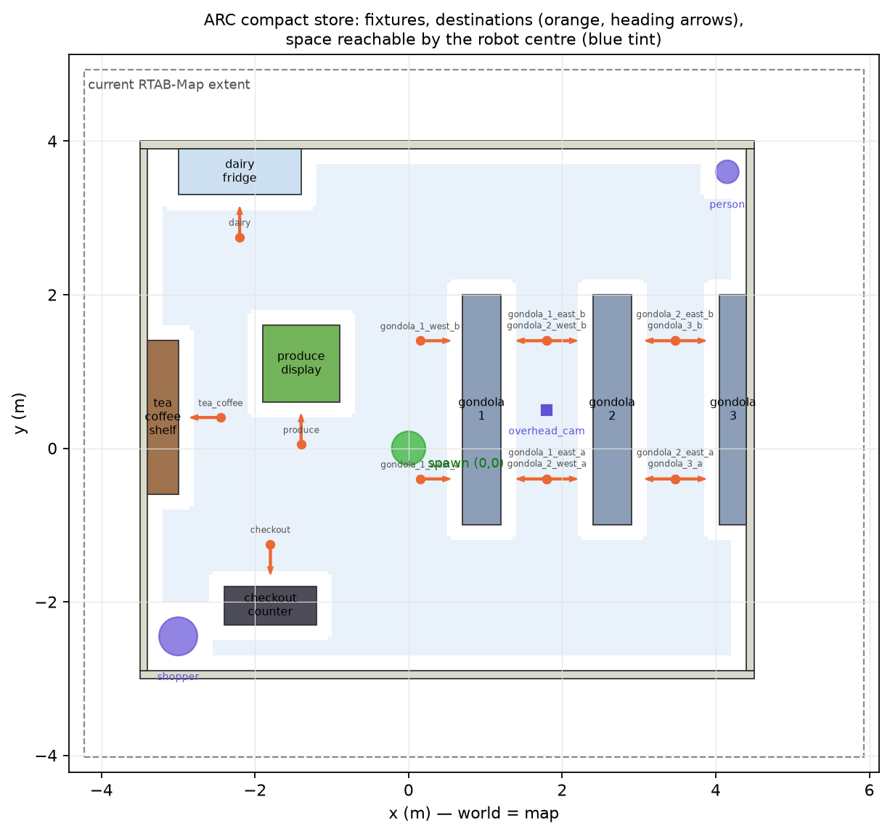

# ARC compact store: runbook

Status key: **DONE** = implemented in this kit · **CHECKED** = verified in the build sandbox ·
**YOUR MACHINE** = can only be tested with ROS 2 / Gazebo on your laptop.
Nothing below claims the robot drives until steps 10–12 pass on your machine.

| Step | What | Status |
|---|---|---|
| 1 | Review existing files, find the authoritative generator | **YOUR MACHINE**: the kit could not see your files; `install.sh` checks them and shows what it will change |
| 2 | Compact layout and coordinate plan | DONE · CHECKED (26/26 geometry checks) |
| 3 | Coordinate-frame alignment | DONE (convention + guard) · verified on **YOUR MACHINE** in step 5 |
| 4 | Files that change | DONE (list below) |
| 5 | Backups | DONE (`install.sh --apply`, with `RESTORE.sh`) · CHECKED on a mock workspace |
| 6 | Code / file changes | DONE · CHECKED (19 unit tests, mock-workspace install) |
| 7 | Rebuild affected packages | YOUR MACHINE |
| 8 | Launch the new world | YOUR MACHINE |
| 9 | Map the store with the LiDAR | YOUR MACHINE |
| 10 | One destination via the Shopping Manager and Dijkstra | YOUR MACHINE |
| 11 | `/planned_path` reaches the controller and the robot moves | YOUR MACHINE (`send_test_goal.py` reports it) |
| 12 | All other destinations | YOUR MACHINE (`send_test_goal.py --all`) |

---

## The layout (step 2)



* Store: X −3.5…4.5 m, Y −3.0…4.0 m (outer wall faces), 0.1 m walls, 1.0 m high. It lies inside
  your current map with 0.7–1.4 m to spare on every side.
* Three gondolas (1.4 m tall, solid footprint): gondola 1 and gondola 2 are double-sided islands,
  gondola 3 is a wall shelf. Aisles are 1.20 m and 1.15 m wide; the cross aisles at both ends are 1.90 m.
* Fruit & vegetable island, milk/refrigerated cabinet (north wall), tea & coffee shelf (west wall),
  checkout counter (south-west).
* 14 destinations, each 0.55–0.60 m from its fixture and facing it: `produce`, `dairy`,
  `tea_coffee`, `checkout`, plus 10 gondola stops (`gondola_N_west_a/b`, `gondola_N_east_a/b`,
  `gondola_3_a/b`).
* Checked in the sandbox (`python3 verify_layout.py`): every destination has ≥ 0.55 m clearance
  (needed 0.32 = robot radius 0.22 + margin 0.10), is reachable from the spawn point for a
  0.22 m-radius robot, and faces its fixture. All free space is connected; no fixture overlaps another.
  Use `--robot-radius` if your TurtleBot is a Burger (0.105) or a custom size.
* Every fixture is one solid box from the floor up. Gazebo's GPU LiDAR ray-casts visuals, so all
  decorative visuals stay inside the collision box: the mapped outline equals the collision outline.

## Coordinate frames (step 3)

**What was wrong.** Item poses were Gazebo-world coordinates (e.g. fruit at (1.9, 7.2), outside
your 10.15 × 8.95 m map). The planner used them directly as map coordinates and ignored `frame_id`.
No `world`↔`map` transform exists, so the two systems were never actually tied together.

**The convention used (and how it is verified, not assumed):**
1. The robot spawns at Gazebo world (0, 0, yaw 0).
2. Gazebo's diff-drive odometry starts at zero at spawn, so `odom` = world at start.
3. RTAB-Map's `map` frame starts aligned with `odom` (map→odom is identity until corrections),
   so `map` = world, apart from RTAB-Map's drift corrections.
4. Every destination is generated directly in `map` coordinates (`destinations_map.yaml`), and the
   remapped `item_locations.yaml` says `map`.
5. **Step 5 below measures** world pose against `map → base_footprint` at several places
   (`check_frames.py`). Only if that passes is "map = world" a fact for this setup.
6. The Dijkstra planner now accepts `map` goals, transforms other frames only through a real TF,
   and **rejects** anything else with a logged reason. Nothing is silently relabelled, and no
   static transform is invented.

Why changing `'world'` to `'map'` in the Shopping Manager is not a cosmetic rename: the
coordinates themselves were regenerated for the map frame, and step 5 checks that it holds.

## Files (step 4)

| File | Change |
|---|---|
| `arc_store_sim/worlds/arc_store.sdf` | **replaced** by the compact world. Your world-level settings (physics, plugins, lights, ground) are copied from the old file; old store models are dropped, except `--keep-model` names |
| `arc_store_sim/worlds/arc_store_compact.sdf` | added (same content, explicit name) |
| `arc_store_sim/config/item_locations.yaml` | **replaced**: same items, IDs, categories and shelf fields; poses moved to compact destinations; frame `map` |
| `arc_store_sim/config/store_layout_compact.json` | added: machine-readable layout and destinations. Your `store_layout.json` is **not** changed, because your `generate_store.py` reads its schema |
| `arc_store_sim/config/destinations_map.yaml` | added: the 14 destinations |
| `arc_store_sim/scripts/compact_store/` | added: the generator, so the world can be regenerated from `layout.py`, which is now the authoritative source for the compact store |
| `arc_planner/arc_planner/goal_frame_guard.py` | added |
| `arc_planner/arc_planner/dijkstra_planner.py` | 2 lines in `shopping_goal_callback` replaced by the guard call |
| `arc_planner/arc_planner/shopping_manager.py` | frame literal `'world'` → `'map'` if present (else unchanged) |

Not touched: launch files, RTAB-Map configuration, robot model, TEB bridge, controller,
`arc_motion_gate`, Behavior Tree, `generate_store.py`, `store_layout.json`.

---

## Steps on your machine

Copy the kit to the laptop and unzip it, e.g. to `~/arc_compact_store_kit`.

### 5a. Dry run (changes nothing)

```bash
cd ~/arc_compact_store_kit && chmod +x install.sh
./install.sh
```
Check:
* the template listing: is there a mannequin/person model you want to keep? Add `--keep-model <name>`.
  The robot is normally spawned by the launch file, so it is not in the world. If yours is in the
  world file, keep it too.
* `staged/item_remap_report.csv`: does each item go to a sensible destination?
* the patch diffs: if the planner patch says **SKIPPED**, your callback differs from the two lines
  quoted; apply the change by hand (see "Manual planner patch" at the end).
* the `generate_store` warning: if a launch or build step runs the old generator, disable it.

### 5b. Install with backups

```bash
./install.sh --apply            # plus any --keep-model you need
```
Note the backup folder and `RESTORE.sh` path it prints.

### 5c. Make the robot spawn at the world origin

```bash
grep -rnE "x_pose|y_pose|yaw|'-x'|\"-x\"|spawn" ~/slam_ws/src/arc_store_sim/launch
```
Set the spawn to x = 0, y = 0, yaw = 0 (launch arguments or defaults), e.g. `x_pose:=0.0 y_pose:=0.0`.
(0, 0) is free space in the compact store, with 0.70 m clearance.

### 7. Rebuild only the affected packages

```bash
cd ~/slam_ws
colcon build --packages-select arc_store_sim arc_planner
source install/setup.bash
ls install/arc_store_sim/share/arc_store_sim/worlds/   # arc_store.sdf should be the new one
grep -c gondola_ install/arc_store_sim/share/arc_store_sim/worlds/arc_store.sdf   # > 0
```

### 8. Launch with a FRESH RTAB-Map database

The old database still holds the old store's map. Move it aside (do not delete it):
```bash
mv ~/.ros/rtabmap.db ~/.ros/rtabmap_old_store_$(date +%Y%m%d).db 2>/dev/null || true
```
(If your launch sets `database_path`, move that file instead. If it already passes `-d` /
`delete_db_on_start`, this is automatic.) Then launch your simulation and RTAB-Map exactly as before.

Check the world loaded: in Gazebo you should see three blue-grey gondolas, a green produce island,
a pale-blue fridge, a brown tea/coffee shelf and a dark checkout counter.

### 9. Map the store by driving it

Teleop slowly (≤ 0.15 m/s forward, ≤ 0.4 rad/s turning) so scan matching keeps up:

1. From the spawn point, turn 360° in place.
2. South along x ≈ 0.15 to the south cross aisle (y ≈ −2), then east to x ≈ 3.5.
3. North up the aisle at x ≈ 3.47 to y ≈ 3, west along the north cross aisle, then south down the aisle at x ≈ 1.8.
4. Back to the spawn point, west past the produce island to the tea/coffee shelf (x ≈ −2.4).
5. North to the fridge (y ≈ 2.7), then around the produce island, south to the checkout (y ≈ −1.3).
6. Return to (0, 0) and turn 360° again (helps loop closure).

Done when, in RViz, `/rtabmap/map` shows **closed outlines** for all 7 fixtures and all 4 walls,
and the area around each destination is free (white), not unknown (grey). Do not enlarge the grid
by hand: unmapped space must be driven.

Now verify the frame convention:
```bash
python3 ~/arc_compact_store_kit/ros_tools/check_frames.py --model <your_robot_model_name> --samples 4
```
**PASS** (≤ 0.15 m, ≤ 5°) means map = world here. If it **fails**: the spawn is not (0, 0, 0), or
RTAB-Map loaded an old database, or odometry starts elsewhere. Fix that before step 10. Do not
compensate with a static transform.

### 10. One destination through the Shopping Manager

Run your usual pipeline with a shopping list holding one fruit/vegetable item, then:
```bash
ros2 topic echo /shopping_goal --once
```
Expect `frame_id: map` and x, y equal to `produce` in `destinations_map.yaml` (−1.4, 0.05).
The planner log should show `[goal_frame_guard] ... ACCEPTED`. If it shows `REJECTED`, the
reason says why (wrong frame, no TF).

### 11. The path reaches the controller and the robot moves

```bash
ros2 topic echo /planned_path --once | head -20      # frame map, poses ending near the goal
```
Watch the robot move in Gazebo. If it does not, check the BT state you entered and
`arc_motion_gate`: the controller may be gated.

Automated version (stop or idle the Shopping Manager first so it does not send competing goals):
```bash
python3 ~/arc_compact_store_kit/ros_tools/send_test_goal.py --dest produce
```
It separates "no path" (planner), "path but no motion" (controller / motion gate / BT state), and
"moved but did not arrive" (tuning).

### 12. All destinations

```bash
python3 ~/arc_compact_store_kit/ros_tools/send_test_goal.py --all --out drive_test_results.csv
```
Then repeat a multi-item list through the Shopping Manager itself. Record both results (pass/fail
per destination, time, final error). Those are the numbers that show the system works.

---

## Manual planner patch (if apply_patches skipped it)

In `dijkstra_planner.py`, at the top of `shopping_goal_callback`, replace the lines that copy
`msg.pose.position.x/y` into the goal with:
```python
        from arc_planner.goal_frame_guard import resolve_goal_for_node
        _res = resolve_goal_for_node(self, msg)
        if not _res.ok:
            return
        self.goal_x = _res.x
        self.goal_y = _res.y
```

## Changing the layout later

Edit `scripts/compact_store/layout.py`, then:
```bash
cd ~/slam_ws/src/arc_store_sim/scripts/compact_store
python3 verify_layout.py --png preview.png        # must say 0 failed
python3 generate_compact_store.py --out-dir /tmp/arcgen --template ../../worlds/arc_store.sdf
```
Re-map the store (step 9) after any geometry change.
