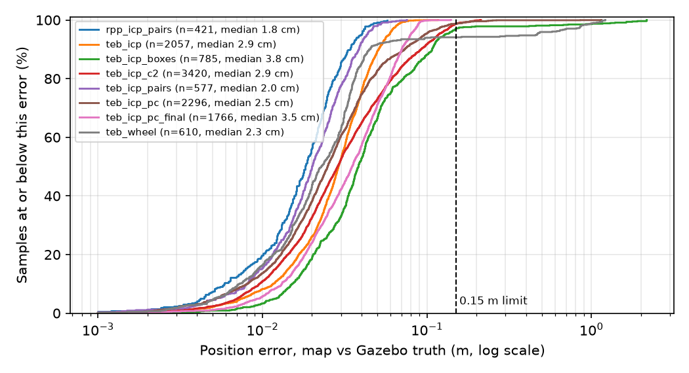
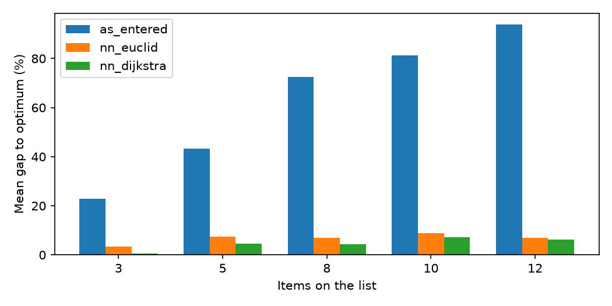

# ARC simulation test results

Source: `/tmp/claude-0/-home-claude/87808992-22e9-5b64-82cd-526ea58bda7e/scratchpad/res1017b/results`. Leg = one drive to one stop. Mission = one shopping list or one start-goal pair. Each label is one stack configuration.

## Data check: false arrivals (counted as failures below)

| Config | Mission | Leg | Planned path (m) | Ended from goal (m) | Leg time (s) |
|---|---|---|---|---|---|
| rpp_icp_pairs | rpp_icp_pairs_s5_018 | 0 | 3.0542 | 1.8 | 34.48 |

These legs were logged as reached, but the robot ended more than 1.0 m from the goal (a stale re-plan of the previous goal was taken as this leg's path).

## A1 Localisation accuracy (map pose vs Gazebo truth, every 2 s)

| Config | Samples (2 s) | Samples (all) | Median err (m) | 95th pct (m) | Max (m) | Median yaw err (deg) | Within 0.15 m / 5 deg | Loss episodes | Truth source |
|---|---|---|---|---|---|---|---|---|---|
| rpp_icp_pairs | 421 | 7430 | 0.018 | 0.039 | 0.058 | 0.46 | 97.9% | 0 | gzcli |
| smoke | 32 | 344 | 0.023 | 0.034 | 0.037 | 0.65 | 96.9% | 0 | gzcli |
| teb_icp | 2057 | 44235 | 0.029 | 0.059 | 0.117 | 0.54 | 96.5% | 1 | gzcli |
| teb_icp_boxes | 785 | 10392 | 0.038 | 0.128 | 2.170 | 0.82 | 91.2% | 8 | gzcli |
| teb_icp_c2 | 3420 | 128047 | 0.029 | 0.117 | 0.213 | 1.01 | 92.1% | 0 | gzcli |
| teb_icp_pairs | 577 | 11865 | 0.020 | 0.043 | 0.076 | 0.46 | 95.1% | 1 | gzcli |
| teb_icp_pc | 2296 | 42303 | 0.025 | 0.096 | 1.149 | 0.66 | 93.7% | 1 | gzcli |
| teb_icp_pc_final | 1766 | 35050 | 0.035 | 0.080 | 0.140 | 0.80 | 91.8% | 1 | gzcli |
| teb_wheel | 610 | 7723 | 0.023 | 0.463 | 1.215 | 0.53 | 83.4% | 21 | gzcli |

Loss episode = error rises above 0.5 m or 15 deg (counted once until it recovers). Samples cover every drive, including returns to the start (leg -1).

Read it as: at a given error on the x-axis, the curve gives the share of samples that were at least that accurate. Curves further left and higher are better; a tail running to the right is a localisation loss.

## A2 Mission reliability

| Config | Strategy | Missions completed | Legs reached | Legs first try | Arrivals by ARC signal | Mission time mean / median (s) | Driven (m, mean) | Recoveries | Collisions | Failures |
|---|---|---|---|---|---|---|---|---|---|---|
| rpp_icp_pairs | pair | 13/20 (65%) | 13/20 | 10/20 | 13/13 | 61.9 / 57.4 | 4.28 | 24 (1.20/mission) | 0 | controller_aborted 6, false_arrival 1 |
| smoke | pair | 1/1 (100%) | 1/1 | 1/1 | 1/1 | 58.1 / 58.1 | 4.29 | 0 (0.00/mission) | 0 | - |
| teb_icp | as_entered | 29/30 (97%) | 143/144 | 96/144 | 143/143 | 280.9 / 255.2 | 18.61 | 97 (3.23/mission) | 0 | controller_aborted 1 |
| teb_icp_boxes | pair | 5/20 (25%) | 5/20 | 3/20 | 5/5 | 55.8 / 51.9 | 3.62 | 44 (2.20/mission) | 17 | controller_aborted 14, localisation_lost 1 |
| teb_icp_c2 | as_entered | 19/30 (63%) | 164/181 | 93/181 | 164/164 | 320.9 / 338.2 | 18.69 | 166 (5.53/mission) | 0 | controller_aborted 17 |
| teb_icp_c2 | exact | 15/30 (50%) | 158/181 | 72/181 | 158/158 | 236.8 / 233.3 | 12.08 | 212 (7.07/mission) | 0 | controller_aborted 23 |
| teb_icp_c2 | nn_dijkstra | 13/30 (43%) | 154/181 | 63/181 | 154/154 | 227.8 / 229.0 | 11.83 | 233 (7.77/mission) | 0 | controller_aborted 27 |
| teb_icp_pairs | pair | 19/20 (95%) | 19/20 | 12/20 | 19/19 | 67.3 / 66.2 | 4.64 | 17 (0.85/mission) | 0 | controller_aborted 1 |
| teb_icp_pc | as_entered | 29/30 (97%) | 140/141 | 136/141 | 140/140 | 289.4 / 259.3 | 18.91 | 4 (0.13/mission) | 1 | localisation_lost 1 |
| teb_icp_pc_final | exact | 30/30 (100%) | 144/144 | 133/144 | 143/144 | 209.3 / 217.5 | 11.57 | 13 (0.43/mission) | 0 | - |
| teb_wheel | as_entered | 4/5 (80%) | 22/23 | 17/23 | 22/22 | 298.2 / 266.1 | 21.39 | 10 (2.00/mission) | 1 | localisation_lost 1 |

- Times and distances are over completed missions. Driven distance is from the Gazebo true pose.
- Recoveries = FollowPath aborts + goal re-sends by the runner (ARC itself has no recovery behaviour; the Shopping Manager would wait forever).
- Collisions = legs whose true pose came within the robot radius of a mapped obstacle cell or a test box (geometry at map resolution, not a contact sensor).

## A4 Reactive avoidance (boxes dropped on the path after planning)

| Config | Runs with boxes | Boxes | Reached | Contacts (clearance <= 0) | Min clearance median (m) | Worst (m) | Recoveries |
|---|---|---|---|---|---|---|---|
| teb_icp_boxes | 18 | 36 | 3/18 | 17 | -0.027 | -0.061 | 40 |

Clearance = true-pose distance from the robot edge (radius 0.105 m) to the box edge.

## Paired comparison: teb_icp_pairs vs rpp_icp_pairs (20 shared missions)

| Metric | teb_icp_pairs | rpp_icp_pairs | Test |
|---|---|---|---|
| Mission time (s), both completed (n=12) | 68.19 | 62.77 | Wilcoxon signed-rank, n=12, p=0.233 |
| Driven distance (m), both completed (n=12) | 4.73 | 4.29 | Wilcoxon signed-rank, n=12, p=0.38 |
| Missions completed | 19/20 | 13/20 | sign test on 8 discordant pairs (7 vs 1), p=0.0703 |
| Stops reached | 19 | 13 | - |
| Recoveries | 17 | 24 | - |
| Smoothness: mean |angular accel| (rad/s^2) | 0.220 | 0.083 | Wilcoxon signed-rank, n=19, p=2.67e-05 |
| Steering reversals per metre (mean) | 1.88 | 0.80 | - |
| Localisation error median / max (m) | 0.020 / 0.076 | 0.018 / 0.058 | - |
| Localisation-loss episodes | 1 | 0 | - |

Smoothness is computed from every /cmd_vel message (TwistStamped from the motion gate), time-differenced in sim time.

## Paired comparison: teb_icp vs teb_wheel (5 shared missions)

| Metric | teb_icp | teb_wheel | Test |
|---|---|---|---|
| Mission time (s), both completed (n=4) | 301.24 | 298.18 | too few pairs |
| Driven distance (m), both completed (n=4) | 21.92 | 21.39 | too few pairs |
| Missions completed | 5/5 | 4/5 | sign test on 1 discordant pairs (1 vs 0), p=1 |
| Stops reached | 24 | 22 | - |
| Recoveries | 16 | 10 | - |
| Smoothness: mean |angular accel| (rad/s^2) | 0.188 | 0.157 | Wilcoxon signed-rank, n=5, p=0.438 |
| Steering reversals per metre (mean) | 1.78 | 0.63 | - |
| Localisation error median / max (m) | 0.030 / 0.117 | 0.023 / 1.215 | - |
| Localisation-loss episodes | 0 | 21 | - |

Smoothness is computed from every /cmd_vel message (TwistStamped from the motion gate), time-differenced in sim time.

## Paired comparison: teb_icp vs teb_icp_pc (30 shared missions)

| Metric | teb_icp | teb_icp_pc | Test |
|---|---|---|---|
| Mission time (s), both completed (n=28) | 276.96 | 287.54 | Wilcoxon signed-rank, n=28, p=0.000135 |
| Driven distance (m), both completed (n=28) | 18.32 | 18.84 | Wilcoxon signed-rank, n=28, p=0.0698 |
| Missions completed | 29/30 | 29/30 | sign test on 2 discordant pairs (1 vs 1), p=1 |
| Stops reached | 143 | 140 | - |
| Recoveries | 97 | 4 | - |
| Smoothness: mean |angular accel| (rad/s^2) | 0.211 | 0.231 | Wilcoxon signed-rank, n=30, p=0.229 |
| Steering reversals per metre (mean) | 2.07 | 2.13 | - |
| Localisation error median / max (m) | 0.029 / 0.117 | 0.025 / 1.149 | - |
| Localisation-loss episodes | 1 | 1 | - |

Smoothness is computed from every /cmd_vel message (TwistStamped from the motion gate), time-differenced in sim time.

## Paired comparison: teb_icp vs teb_icp_pc_final (30 shared missions) (paired by shopping list; the visiting order differs)

| Metric | teb_icp | teb_icp_pc_final | Test |
|---|---|---|---|
| Mission time (s), both completed (n=29) | 280.95 | 207.39 | Wilcoxon signed-rank, n=29, p=5.1e-07 |
| Driven distance (m), both completed (n=29) | 18.61 | 11.52 | Wilcoxon signed-rank, n=29, p=1.23e-07 |
| Missions completed | 29/30 | 30/30 | sign test on 1 discordant pairs (0 vs 1), p=1 |
| Stops reached | 143 | 144 | - |
| Recoveries | 97 | 13 | - |
| Smoothness: mean |angular accel| (rad/s^2) | 0.211 | 0.273 | Wilcoxon signed-rank, n=29, p=0.000809 |
| Steering reversals per metre (mean) | 2.07 | 3.01 | - |
| Localisation error median / max (m) | 0.029 / 0.117 | 0.035 / 0.140 | - |
| Localisation-loss episodes | 1 | 1 | - |

Smoothness is computed from every /cmd_vel message (TwistStamped from the motion gate), time-differenced in sim time.

## Paired comparison: teb_icp_pc vs teb_icp_pc_final (30 shared missions) (paired by shopping list; the visiting order differs)

| Metric | teb_icp_pc | teb_icp_pc_final | Test |
|---|---|---|---|
| Mission time (s), both completed (n=29) | 289.44 | 208.02 | Wilcoxon signed-rank, n=29, p=7.08e-08 |
| Driven distance (m), both completed (n=29) | 18.91 | 11.51 | Wilcoxon signed-rank, n=29, p=7.45e-09 |
| Missions completed | 29/30 | 30/30 | sign test on 1 discordant pairs (0 vs 1), p=1 |
| Stops reached | 140 | 144 | - |
| Recoveries | 4 | 13 | - |
| Smoothness: mean |angular accel| (rad/s^2) | 0.231 | 0.273 | Wilcoxon signed-rank, n=30, p=0.0128 |
| Steering reversals per metre (mean) | 2.13 | 3.01 | - |
| Localisation error median / max (m) | 0.025 / 1.149 | 0.035 / 0.140 | - |
| Localisation-loss episodes | 1 | 1 | - |

Smoothness is computed from every /cmd_vel message (TwistStamped from the motion gate), time-differenced in sim time.

## C2 Ordering strategies, planned vs driven (teb_icp_c2)

| Strategy | Completed | Planned J (m, mean) | Driven (m, mean) | Time (s, mean) | Driven / planned (median) |
|---|---|---|---|---|---|
| as_entered | 19/30 | 25.29 | 18.69 | 320.9 | 0.83 |
| exact | 15/30 | 14.56 | 12.08 | 236.8 | 0.86 |
| nn_dijkstra | 13/30 | 15.14 | 11.83 | 227.8 | 0.85 |

- driven distance, nn_dijkstra vs as_entered: Wilcoxon signed-rank, n=9, p=0.00391
- time, nn_dijkstra vs as_entered: Wilcoxon signed-rank, n=9, p=0.00391
- driven distance, nn_dijkstra vs exact: Wilcoxon signed-rank, n=9, p=0.91
- time, nn_dijkstra vs exact: Wilcoxon signed-rank, n=9, p=0.82

Planned J is the kit's Dijkstra cost from home through the stops (no return). Driven distance stops at the arrival point, so a ratio slightly below 1 is possible.

## C1 Ordering benchmark (offline, Dijkstra path cost)

| Items | Lists | Driving stops (mean) | Optimal J (m, mean) | As entered: gap mean / p95 / % optimal | NN Euclidean | NN Dijkstra | Exact solve max (ms) |
|---|---|---|---|---|---|---|---|
| 3 | 50 | 2.7 | 8.83 | 22.9 / 68.4 / 26% | 3.5 / 20.5 / 74% | 0.6 / 4.7 / 90% | 0.1 |
| 5 | 50 | 4.1 | 12.11 | 43.4 / 94.4 / 0% | 7.4 / 25.8 / 38% | 4.5 / 20.1 / 56% | 0.1 |
| 8 | 50 | 5.8 | 14.76 | 72.6 / 114.8 / 0% | 7.1 / 25.8 / 30% | 4.4 / 22.1 / 60% | 1.3 |
| 10 | 50 | 6.5 | 15.31 | 81.2 / 126.0 / 0% | 8.8 / 26.5 / 24% | 7.3 / 25.1 / 44% | 2.3 |
| 12 | 50 | 7.5 | 16.29 | 93.8 / 140.1 / 0% | 6.9 / 23.3 / 20% | 6.2 / 19.7 / 56% | 4.8 |

Gap = (route cost - optimum) / optimum, in %. Unreachable lists are excluded. Items on the same aisle spot count as one driving stop.

## Logged events

| Config | box_removed | box_spawned | controller_aborted | controller_still_busy | goal_reached_msg | goal_resent | goal_resent_no_path | goal_sent | leg_failed | localisation_lost | mission_end | mission_start | path_received | reached_msg_far | runner_cancelled_follow_path | sim_link_lost | stall | start_not_reached | stray_boxes_removed | truth_gap | wait_controller_idle |
|---|---|---|---|---|---|---|---|---|---|---|---|---|---|---|---|---|---|---|---|---|---|
| rpp_icp_pairs | 0 | 0 | 31 | 1 | 27 | 18 | 2 | 40 | 13 | 0 | 20 | 20 | 40 | 0 | 0 | 0 | 0 | 7 | 0 | 3 | 3 |
| smoke | 0 | 0 | 1 | 0 | 2 | 1 | 0 | 2 | 0 | 0 | 1 | 1 | 2 | 0 | 0 | 0 | 0 | 0 | 0 | 0 | 0 |
| teb_icp | 0 | 0 | 62 | 0 | 176 | 61 | 12 | 178 | 2 | 0 | 31 | 31 | 178 | 0 | 1 | 1 | 0 | 0 | 0 | 48 | 0 |
| teb_icp_boxes | 41 | 41 | 45 | 4 | 27 | 28 | 2 | 49 | 22 | 2 | 24 | 25 | 49 | 3 | 4 | 0 | 9 | 4 | 5 | 0 | 6 |
| teb_icp_c2 | 0 | 0 | 324 | 3 | 561 | 348 | 1 | 633 | 72 | 0 | 90 | 90 | 633 | 96 | 0 | 0 | 0 | 5 | 0 | 418 | 27 |
| teb_icp_pairs | 0 | 0 | 18 | 0 | 39 | 16 | 3 | 42 | 3 | 0 | 21 | 21 | 42 | 0 | 1 | 1 | 0 | 1 | 0 | 20 | 0 |
| teb_icp_pc | 0 | 0 | 0 | 0 | 170 | 5 | 2 | 171 | 1 | 1 | 30 | 30 | 171 | 5 | 1 | 0 | 0 | 0 | 0 | 43 | 0 |
| teb_icp_pc_final | 0 | 0 | 2 | 0 | 173 | 12 | 3 | 174 | 0 | 0 | 30 | 30 | 174 | 10 | 0 | 0 | 0 | 0 | 1 | 25 | 0 |
| teb_wheel | 0 | 0 | 8 | 0 | 28 | 10 | 1 | 30 | 2 | 2 | 6 | 6 | 30 | 3 | 1 | 0 | 1 | 0 | 0 | 0 | 0 |

## Notes

- Simulation only: TurtleBot3 Burger in the compact store; not the cart, not real motors.
- BT mode during logged samples (LEAD caps linear speed at 0.10 m/s, FOLLOW passes the controller command): rpp_icp_pairs: LEAD 100%; smoke: LEAD 100%; teb_icp: LEAD 100%, unknown 0%; teb_icp_boxes: LEAD 100%, unknown 0%; teb_icp_c2: LEAD 100%, unknown 0%; teb_icp_pairs: LEAD 99%, unknown 1%; teb_icp_pc: LEAD 100%; teb_icp_pc_final: LEAD 100%; teb_wheel: LEAD 100%.
- The runner stands in for the Shopping Manager. ARC's shopping_manager.py visits items in the order entered; nn_dijkstra and exact orderings are the kit's implementations.
- Report medians and percentiles, not single runs. Re-run with a different --seed before claiming a trend.
