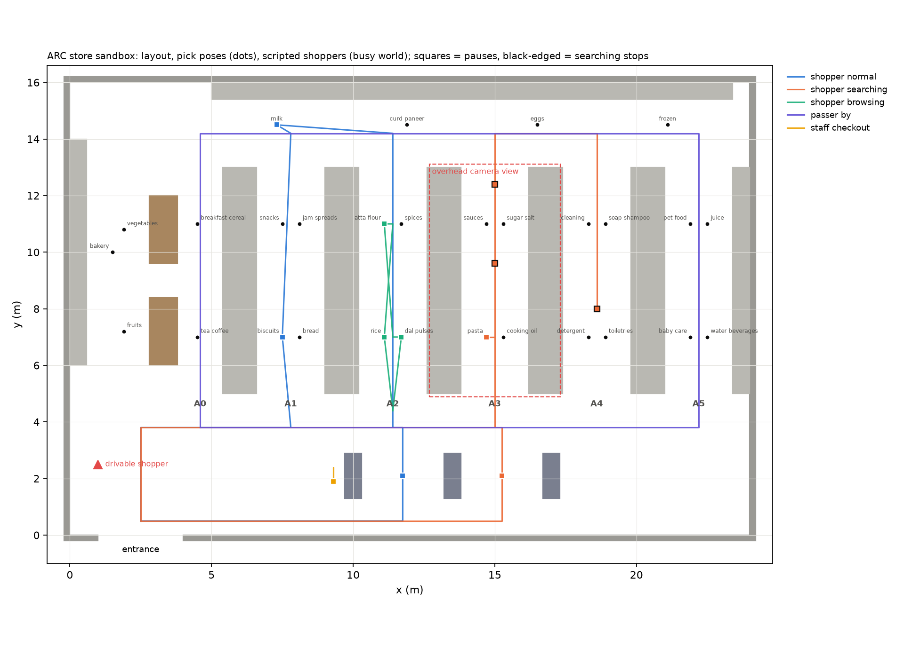

# arc_store_sim: supermarket sandbox for ARC

A Gazebo Harmonic (gz-sim 8) store for ROS 2 Jazzy, built to test ARC's
**follow → offer help → lead** behaviour with known ground truth.

It is a stand-alone package. It starts a world and a ROS–Gazebo bridge only.
It does **not** spawn or modify the ARC robot, Dijkstra, the TEB-like
controller, the behaviour tree, RTAB-Map or TF.



## What's in the store

| Thing | Details |
|---|---|
| Store | 24 m × 16 m, 3.5 m walls, entrance at the south-west (x 1–4 m) |
| Aisles | 5 double-sided gondolas (1.8 m tall), aisles A0–A5 each 2.4 m wide, plus front and back cross-aisles |
| Wall shelving | Dairy and frozen along the north wall, beverages east, bakery west |
| Other | 3 checkout counters, 2 produce tables, ceiling lights |
| Items | 29 categories with **pick poses** in `config/item_locations.yaml` (where to stand, facing the shelf) |
| `shopper` | A drivable test person. You steer it with `/shopper/cmd_vel`; it publishes its true pose on `/shopper/odom` |
| Scripted people | Walking human meshes on fixed routes, with **ground-truth positions and behaviour labels** |
| Overhead camera | A fixed ceiling camera over aisle 3 (1280×720, 15 Hz), similar to the multiple_3 view |
| Map | Ground-truth occupancy map, `maps/store_map.yaml` (5 cm cells) |

World frame: x east, y north, origin at the store's south-west inner corner.

## Worlds

| World | People | Use |
|---|---|---|
| `arc_store.sdf` | drivable shopper only | Following / leading tests, where you play the shopper |
| `arc_store_normal.sdf` | `shopper_normal` | Negative case: finds biscuits and milk directly |
| `arc_store_searching.sdf` | `shopper_searching` | Positive case: walks past the pasta, stops, turns back, tries aisle 4, returns, finds it |
| `arc_store_busy.sdf` | all 5 | Crowding and hard negatives: a browser who walks back and forth but stops *at* items, a passer-by, and checkout staff |

`scenarios/scenarios.yaml` states, for each scripted person, whether a
help-offer **should** fire, and when the "no progress" window is.
`scenarios/*_truth.csv` gives each person's position at 10 Hz, with a behaviour
label. `*_labels.csv` gives the same information as time intervals. Each
scripted person loops, so use `t mod cycle_s`.

These are scripted, observable movement patterns. They are not a model of
anyone's state of mind.

## Install (on the ARC laptop)

```bash
sudo apt install ros-jazzy-ros-gz ros-jazzy-teleop-twist-keyboard python3-opencv
cp -r arc_store_sim ~/slam_ws/src/
cd ~/slam_ws && colcon build --packages-select arc_store_sim && source install/setup.bash
```

## Run

```bash
ros2 launch arc_store_sim store.launch.py                               # busy store with GUI
ros2 launch arc_store_sim store.launch.py world:=arc_store_searching.sdf
ros2 launch arc_store_sim store.launch.py world:=arc_store.sdf          # just you and the store

# drive the test shopper (second terminal)
ros2 run teleop_twist_keyboard teleop_twist_keyboard --ros-args -r cmd_vel:=/shopper/cmd_vel

# record the overhead camera for the perception pipeline (also writes <name>_frames.csv)
ros2 launch arc_store_sim store.launch.py world:=arc_store_busy.sdf record:=true record_path:=busy_aisle3.mp4
```

Then the perception tooling works unchanged:
`python track_and_log_v2.py --source busy_aisle3.mp4 --run-name sim_busy_baseline`.

### Spawning ARC

Use ARC's own robot description. Do not add it to this package. For example,
with `robot_state_publisher` already running from ARC's package:

```bash
ros2 run ros_gz_sim create -name arc -topic robot_description -x 2.5 -y 1.0 -z 0.05 -Y 1.5708
```

That places ARC just inside the entrance, facing into the store.

## First run: please check these

This package was generated and checked **offline**. Gazebo was not available
where it was built, so nobody has opened these worlds in Gazebo yet. On the
first launch, check:

1. **The world loads** without SDF errors in the terminal.
2. **The scripted people appear and walk.** Their mesh is the standard Gazebo
   Fuel actor, downloaded on first run, so this needs internet once. If they
   are invisible, check the terminal for a Fuel download error.
3. **The drivable shopper moves** with teleop and stays upright.
4. **The `/shopper/odom` frame.** Drive 1 m forward and read the pose. If it
   starts near (0, 0) rather than the spawn (1.0, 2.5), odometry is relative to
   spawn: add the spawn offset when scoring.
5. **The overhead camera.** `ros2 run rqt_image_view rqt_image_view` →
   `/store/overhead_cam/image` should show aisle 3 from above.
6. **Real-time factor** in the GUI (bottom right). If it is well below 1.0 on
   the laptop, run headless:
   `gz_extra_args:='-s --headless-rendering'`.

Write down what you see. Those observations are the sandbox's validation.

## Things to know

- **Scripted people have no collision.** The robot can drive through them, and a
  CPU ray LiDAR will not see them. A **GPU LiDAR** (`gpu_lidar`) and cameras
  do see them, because they are rendered.
- **The drivable shopper is made of simple shapes.** YOLO is not expected to
  detect it reliably. Use it to test the follow/lead control logic with
  ground-truth pose. Use the scripted people (human meshes) to test perception.
- **Timing.** Scripted routes use `tension="1"`, so people walk straight
  between waypoints and slow down at corners. The truth CSV models this. Check
  the actual timing against a recording once.

## Editing the store

Edit `config/store_layout.json` (aisle positions, shelf categories, camera
pose, spawn), then:

```bash
python3 scripts/generate_store.py           # rewrites worlds/, config/item_locations.yaml, maps/, scenarios/, docs/layout.png
python3 -m unittest discover -s test -v     # 12 offline checks: SDF structure, collision-free routes, pick poses, labels
colcon build --packages-select arc_store_sim
```

The scripted routes live in `scenario_actors()` in the generator. The tests
fail if any route passes within 0.3 m of a shelf, counter, table or wall.

## Credits

The walking-person mesh is the "actor" model on Gazebo Fuel
(`fuel.gazebosim.org/1.0/Mingfei/models/actor`). Everything else is generated
from geometric primitives.
